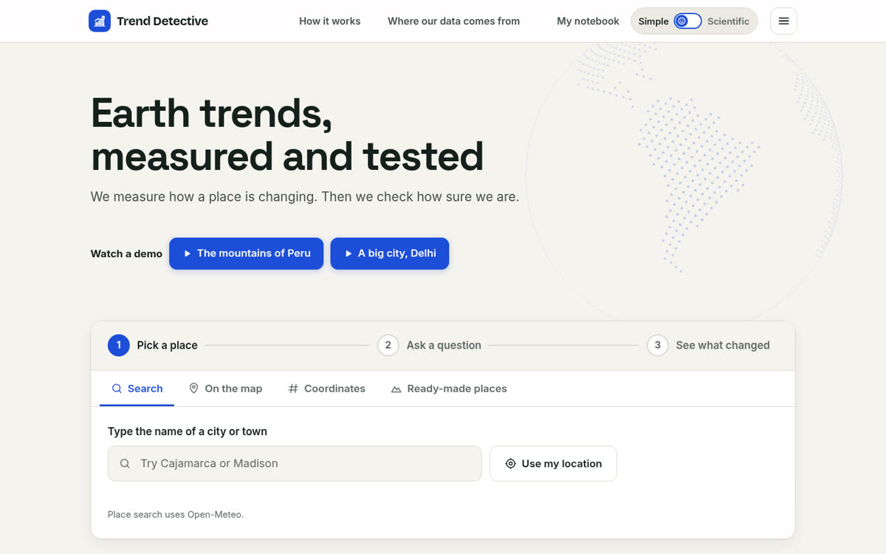
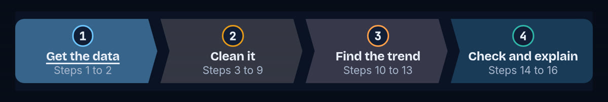
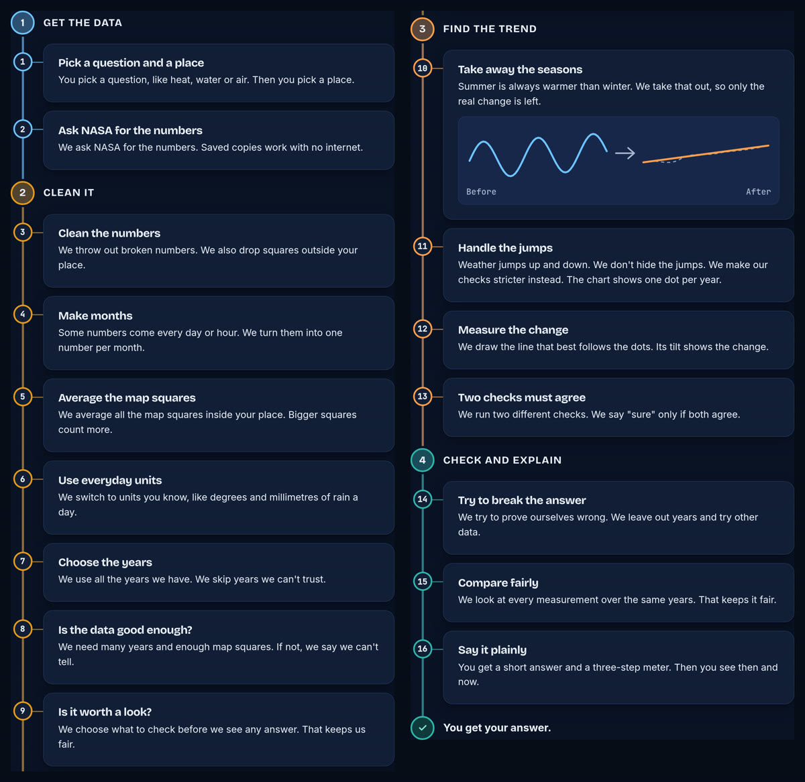
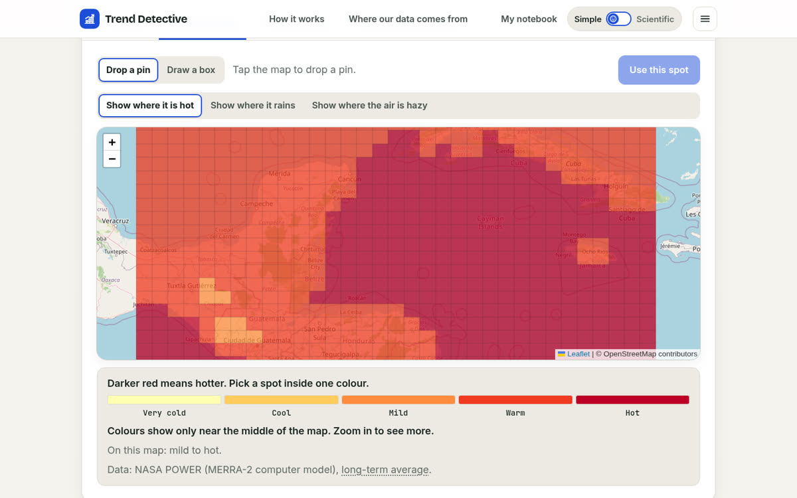
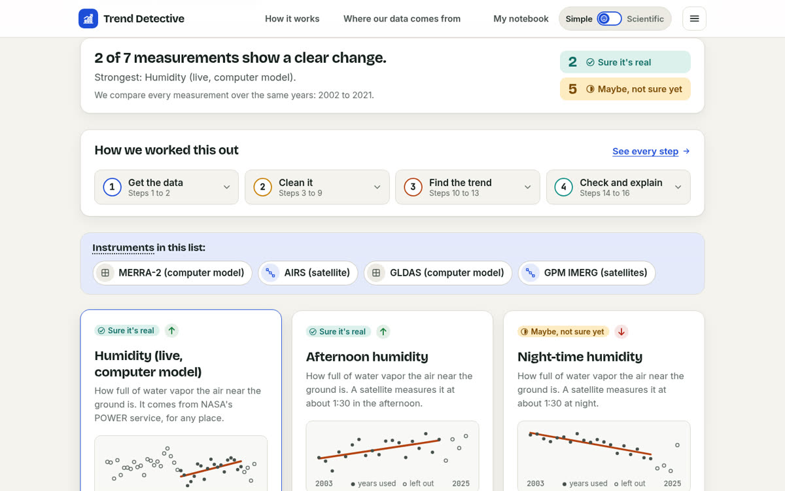
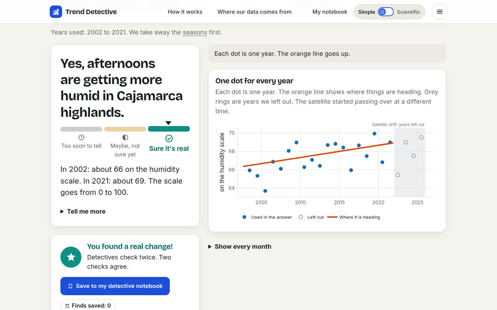
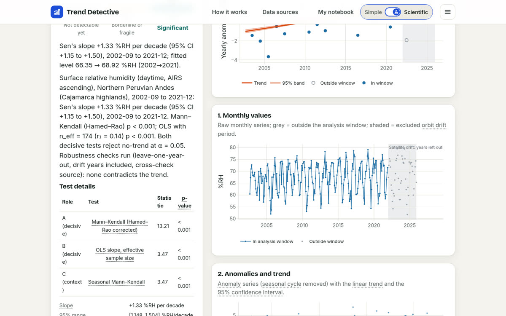
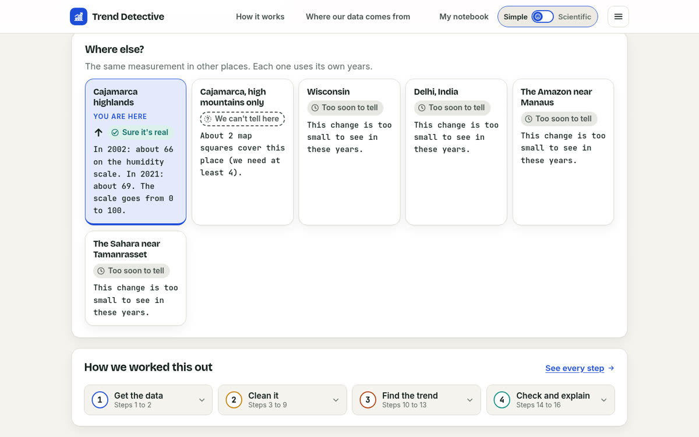

# Trend Detective: Earth trends, measured and tested

**NASA Space Apps Challenge 2026 · "Be An Earth System Trend Detective!"**

Pick a place and a plain question (heat, water or air). Trend Detective picks the NASA variables that can answer it,
removes the seasonal cycle, measures the change per 10 years with a 95% range, and tests whether it is real.
Every answer comes in a **Simple** view a 9-year-old can read and a **Scientific** view with the full numbers, in
**English or Spanish**.

▶ **[Watch the 29-second demo](https://rennleon.github.io/hackaton-nasa-space-apps-2026/)** ·
[Full documentation](docs/DETAILS.md) · [Changelog](CHANGELOG.md)



## How it answers the challenge

| Objective | What Trend Detective does |
|---|---|
| **1. Identify variables** | A plain question picks the NASA variables declared for it. Each card has a one-line definition, why it is worth a look, its mission or model, and a second instrument as a cross-check. Variables that can't answer here say why. |
| **2. Acquire data for a region** | Six ready-made places that work offline, or **any place on Earth**: search a town, click the map (point or box up to 10° × 10°) or type coordinates. Data from **NASA Giovanni** and **NASA POWER**. |
| **3. Time series + visualization** | At least 15 years of monthly data, **seasonal cycle removed**, one dot per year and the trend line (Scientific view: monthly series and 95% band). |
| **4. Rate of change + significance** | **Sen's slope** per 10 years with a persistence-corrected 95% range. *Sure it's real* only when **Mann–Kendall (Hamed–Rao)** and an **OLS t-test with effective sample size** agree at α = 0.05. |

Also: two guided demos to watch, a kid-word dictionary for every term, *"Too soon to tell, we'd know in about N
more years"* instead of "no change", and **"Where else?"** to see the same variable trend differently by region.

## The pipeline: 16 steps in 4 stages





In science terms: monthly NASA series → area-weighted box mean → seasonal cycle removed → **Sen's slope** per 10
years with a Hamed–Rao 95% range → **Mann–Kendall (Hamed–Rao)** and **OLS t-test with effective sample size** must
both agree at α = 0.05 → robustness checks (leave one year out, other start years, second source, known breaks).
The same path is in the app at *How it works*.

## See it

| Pick any place | Variables worth testing |
|---|---|
|  |  |
| **The answer, for everyone** | **The full numbers, for scientists** |
|  |  |



A *Sure it's real* result earns a **"You found a real change!"** badge and can be saved to a **detective
notebook** (kept in your browser only) and shared as a plain-text report or JSON.

## Honest by design

- Variables are chosen **before** any trend is computed, so the tool can't go fishing for significant results.
- Known instrument and model breaks (Aqua orbit drift, OMI row anomaly, MERRA-2 input changes) lower the
  certainty: a window across a break is never *Sure it's real*.
- The app never writes "caused by", "proves" or "no change". Model outputs say "computer model estimate".

## NASA data used

| Instrument / model | Variables |
|---|---|
| **AIRS** (Aqua) | Surface air temperature and relative humidity, day and night |
| **GPM IMERG** | Precipitation |
| **GLDAS Noah** | Soil moisture (0–10 cm), evapotranspiration |
| **MERRA-2** | Sulfate and organic carbon particles |
| **OMI** (Aura) | Aerosol optical depth (UV), nitrogen dioxide |
| **NASA POWER** | Temperature, precipitation, humidity, aerosol optical depth, climate maps |

## Run it

Needs **Node ≥ 20** and **[uv](https://docs.astral.sh/uv/)**:

```bash
npm install && npm run dev     # API on :8000, web app on http://localhost:5173
```

The demos and ready-made places run from saved NASA results, with no network needed. Live Giovanni data needs an
Earthdata token in `backend/.env` (see `backend/.env.example`); NASA POWER works without login. Tests:
`npm test`. Developer guide, configuration and the full method: [docs/DETAILS.md](docs/DETAILS.md).

**Stack:** React 19, TypeScript, Vite, Leaflet, Plotly · Python, FastAPI, NumPy, SciPy, pymannkendall.

## Credits, AI use and references

- **Data:** NASA Giovanni (GES DISC), NASA POWER and the missions above. Map tiles © OpenStreetMap contributors;
  place search by Open-Meteo; IPCC AR6 reference regions (Iturbide et al. 2020).
- **Methods:** Gilbert (1987), Hamed & Rao (1998), Weatherhead et al. (1998), Benjamini & Hochberg (1995),
  Wilks (2016), Liebmann et al. (2010), Randles et al. (2017). Full list: [docs/sources-checked.md](docs/sources-checked.md).
- **AI use:** the team used AI coding assistants (Claude Code by Anthropic) to help write code and text, and the
  demo video was scripted, recorded and captioned with Claude Code (disclosed on every frame). **The app itself uses
  no AI:** every number comes from NASA data and our own statistics code.
- **Music in the demo:** "Chill Out Theme" by Komiku, CC0 1.0, via Wikimedia Commons.

> This is a NASA Space Apps Challenge project. It is not endorsed by NASA and uses no NASA logos.
